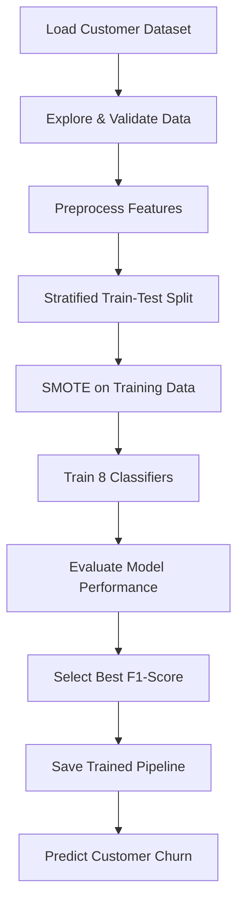

#  Telco Customer Churn Prediction

<p align="center">
  
</p>

<p align="center">
  <b>Turning customer data into actionable churn insights.</b>
  <br/>
  An end-to-end machine learning project to analyze customer behavior, predict churn, and compare classification models.
</p>

<p align="center">
  
  
  
  
  
</p>

<p align="center">
  <a href="#-overview">Overview</a> •
  <a href="#-features">Features</a> •
  <a href="#-models">Models</a> •
  <a href="#-results">Results</a> •
  <a href="#-installation">Installation</a>
</p>


##  Overview

Customer churn is one of the biggest challenges in the telecommunications industry. Losing customers impacts revenue, increases acquisition costs, and makes long-term growth harder.

**Telco Customer Churn Prediction** uses machine learning to identify patterns associated with customer churn and evaluate models that can distinguish between customers who leave and those who stay.

The project follows a complete machine learning workflow, from data exploration and preprocessing to model evaluation and saving the best-performing pipeline.

>  **Goal:** Build a reproducible classification workflow that helps explore customer churn and supports data-driven retention strategies.

##  Features

-  **Exploratory Data Analysis** — Visualize churn patterns and customer behavior.
-  **Data Preprocessing** — Handle missing values, encode categorical features, and scale numerical data.
-  **Class Imbalance Handling** — Apply SMOTE to the training data.
-  **Multi-Model Training** — Train and compare eight classification algorithms.
-  **Model Evaluation** — Measure accuracy, precision, recall, F1-score, and ROC-AUC.
-  **Visual Analytics** — Generate confusion matrices, ROC curves, and model comparison charts.
-  **Model Persistence** — Save the best fitted pipeline using Joblib.
-  **Prediction Demo** — Generate a churn prediction and estimated churn probability for a sample customer.

##  Tech Stack

| Category | Tools |
|---|---|
| Language | Python |
| Data analysis | Pandas, NumPy |
| Visualization | Matplotlib, Seaborn |
| Machine learning | Scikit-learn, XGBoost |
| Imbalanced learning | Imbalanced-learn, SMOTE |
| Model persistence | Joblib |
| Version control | Git, GitHub |

##  Project Structure

```text
telco-customer-churn-github/
│
├── data/
│   └── README.md
│
├── models/
│   └── .gitkeep
│
├── notebooks/
│   └── README.md
│
├── reports/
│   └── figures/
│       └── .gitkeep
│
├── src/
│   ├── __init__.py
│   ├── data.py
│   ├── features.py
│   ├── modeling.py
│   ├── evaluate.py
│   └── visualize.py
│
├── .gitignore
├── requirements.txt
├── run.py
└── README.md
```

##  Dataset

This project uses the **Telco Customer Churn** dataset, which contains customer information such as:

- Customer demographics and tenure
- Internet and phone services
- Contract type and payment method
- Monthly charges and total charges
- Customer churn status

###  Target variable

| Value | Meaning |
|---|---|
| `Yes` | Customer churned |
| `No` | Customer stayed |

The target is converted to a binary classification label: `1` for churn and `0` for non-churn.

### Dataset setup

The dataset is not included in this repository.

1. Obtain the dataset from a source you are permitted to use.
2. Place the CSV file in the `data/` directory.
3. Ensure the filename is exactly:

```text
data/WA_Fn-UseC_-Telco-Customer-Churn.csv
```

See [`data/README.md`](data/README.md) for additional information.

##  Models Implemented

This project compares eight machine learning classifiers:

| # | Model | Approach |
|---:|---|---|
| 01 | Logistic Regression | Linear classification |
| 02 | K-Nearest Neighbors | Distance-based classification |
| 03 | Decision Tree | Rule-based classification |
| 04 | Random Forest | Tree ensemble |
| 05 | Support Vector Machine | Margin-based classification |
| 06 | AdaBoost | Adaptive boosting |
| 07 | Gradient Boosting | Sequential boosting |
| 08 | XGBoost | Optimized gradient boosting |

Each model is evaluated on the same held-out test set. The best model is selected according to its **F1-score**.

##  Machine Learning Workflow



### Preprocessing strategy

- Remove the customer identifier from predictive features.
- Convert the churn target to binary labels.
- Impute missing numerical values with the median.
- Impute missing categorical values with the most frequent category.
- One-hot encode categorical features.
- Standardize numerical features.
- Apply SMOTE only within the training pipeline.
- Use an 80/20 stratified train-test split with a fixed random seed.

Keeping preprocessing and SMOTE inside the fitted pipeline helps prevent information from the held-out test set leaking into model training.

##  Results & Visualizations

The project automatically generates visualizations and a metrics report when `run.py` finishes successfully.

###  Model comparison

<p align="center">
  
</p>

###  Churn distribution

<p align="center">
  
</p>

###  ROC curve comparison

<p align="center">
  
</p>

*Run the project to generate these images before expecting them to appear on GitHub.*

### Evaluation metrics

| Metric | What it tells us |
|---|---|
| Accuracy | Overall proportion of correct predictions |
| Precision | How many predicted churners actually churned |
| Recall | How many actual churners were identified |
| F1-score | Balance between precision and recall |
| ROC-AUC | How well the model ranks churners above non-churners |

**Why F1-score?**

A model can achieve reasonable accuracy while failing to identify customers who are likely to leave. F1-score helps balance precision and recall, which is useful for comparing models on an imbalanced churn dataset.

The most appropriate business metric ultimately depends on the cost of missed churners versus unnecessary retention offers.

### Generated outputs

After a successful run:

```text
reports/
├── model_metrics.csv
└── figures/
    ├── churn_distribution.png
    ├── contract_vs_churn.png
    ├── tenure_vs_churn.png
    ├── monthly_charges_vs_churn.png
    ├── model_comparison_f1.png
    ├── roc_curve_comparison.png
    └── confusion_matrix_*.png

models/
└── best_model.joblib
```

The confusion matrix files are generated separately for each evaluated model.

##  Installation

### Prerequisites

- Python 3.10 or newer
- Git (for cloning the repository)
- The required customer churn dataset

### 1. Clone the repository

```bash
git clone https://github.com/YOUR-USERNAME/telco-customer-churn-github.git
cd telco-customer-churn-github
```

Replace `YOUR-USERNAME` with your GitHub username and update the repository name if necessary.

### 2. Create a virtual environment

**Windows — PowerShell:**

```powershell
py -m venv .venv
.\.venv\Scripts\Activate.ps1
```

If PowerShell blocks activation, open Command Prompt and use:

```bat
.venv\Scripts\activate.bat
```

**macOS / Linux:**

```bash
python3 -m venv .venv
source .venv/bin/activate
```

### 3. Install dependencies

```bash
python -m pip install --upgrade pip
pip install -r requirements.txt
```

### 4. Add the dataset

Place `WA_Fn-UseC_-Telco-Customer-Churn.csv` inside the `data/` directory.

### 5. Run the pipeline

```bash
python run.py
```

The program will:

1. Load and validate the dataset.
2. Print dataset information and data-quality checks.
3. Generate exploratory visualizations.
4. Train and evaluate all eight models.
5. Save model metrics and comparison charts.
6. Select the best model by F1-score.
7. Save the fitted pipeline.
8. Demonstrate a sample prediction.

##  Using the Saved Model

Once the pipeline has been trained, load it for predictions:

```python
import joblib
import pandas as pd

model = joblib.load("models/best_model.joblib")

# Replace this example with a DataFrame containing
# the original feature columns expected by the pipeline.
customer_data = pd.DataFrame([
    {
        "gender": "Female",
        "SeniorCitizen": 0,
        "Partner": "Yes",
        "Dependents": "No",
        "tenure": 12,
        "PhoneService": "Yes",
        "MultipleLines": "No",
        "InternetService": "DSL",
        "OnlineSecurity": "No",
        "OnlineBackup": "Yes",
        "DeviceProtection": "No",
        "TechSupport": "No",
        "StreamingTV": "No",
        "StreamingMovies": "No",
        "Contract": "Month-to-month",
        "PaperlessBilling": "Yes",
        "PaymentMethod": "Electronic check",
        "MonthlyCharges": 65.0,
        "TotalCharges": 780.0,
    }
])

prediction = model.predict(customer_data)[0]
probability = model.predict_proba(customer_data)[0, 1]

print("Prediction:", "Churn" if prediction == 1 else "No churn")
print(f"Estimated churn probability: {probability:.2%}")
```

The sample uses illustrative customer values. The saved pipeline expects the original feature columns, with names and data types matching those used during training.

The predicted probability is a model estimate, not a guarantee that a customer will churn.

##  Key Learnings

- End-to-end machine learning pipeline development
- Exploratory data analysis and feature preparation
- Handling imbalanced classification datasets
- Training and comparing multiple algorithms
- Evaluating models with classification metrics
- Preventing preprocessing and resampling leakage
- Saving and reusing fitted machine learning pipelines

##  Future Improvements

- [ ] Hyperparameter tuning with cross-validation
- [ ] Explainable AI with SHAP
- [ ] Probability calibration and threshold optimization
- [ ] Interactive dashboard using Streamlit
- [ ] REST API deployment using FastAPI
- [ ] Model monitoring and data drift detection
- [ ] Business-focused churn retention analysis

##  Limitations

- Performance depends on the dataset and its representativeness.
- Test-set results do not guarantee performance on future customers.
- F1-score may not fully capture the business cost of different errors.
- The project is an offline machine learning workflow, not a deployed production service.

##  Author

**Your Name**

<p>
  <a href="https://github.com/YOUR-VISMAYA">
    
  </a>
  <a href="https://www.linkedin.com/in/YOUR-LINKEDIN-Vismaya B/">
    
  </a>
</p>

Replace the placeholders with your profile details.

##  License

A license has not yet been specified. Add a `LICENSE` file before redistributing the source code. Ensure that the dataset's own terms are respected separately.

---

<p align="center">
  <b>Built with Python, machine learning, and curiosity. </b>
  <br/>
  If you find this project useful, consider giving the repository a 
</p>

<p align="center">
  
</p>
